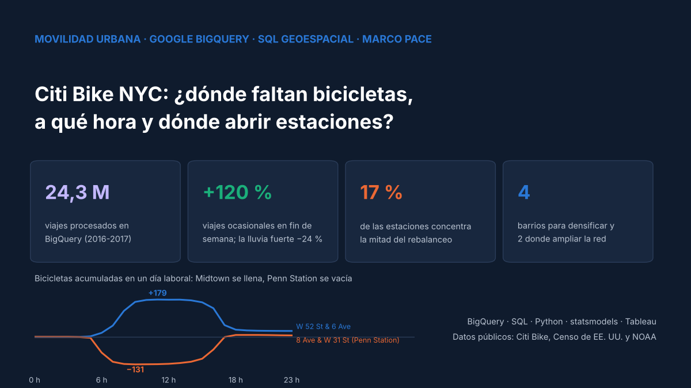
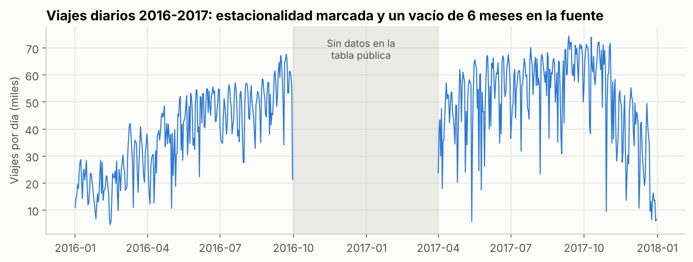
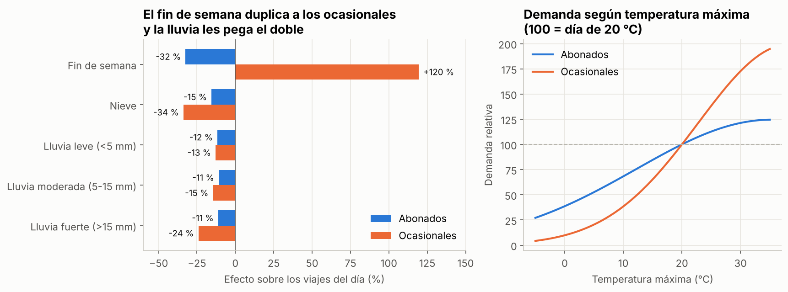
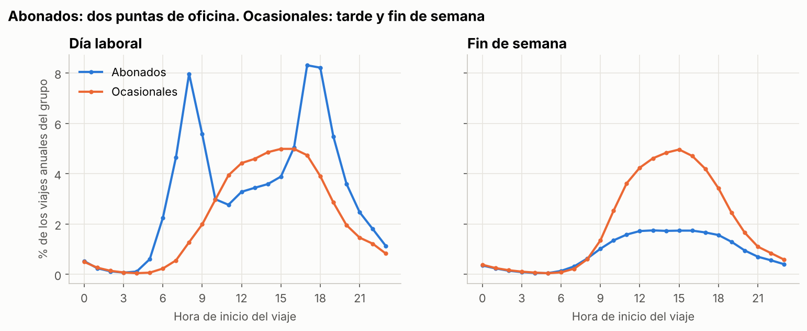
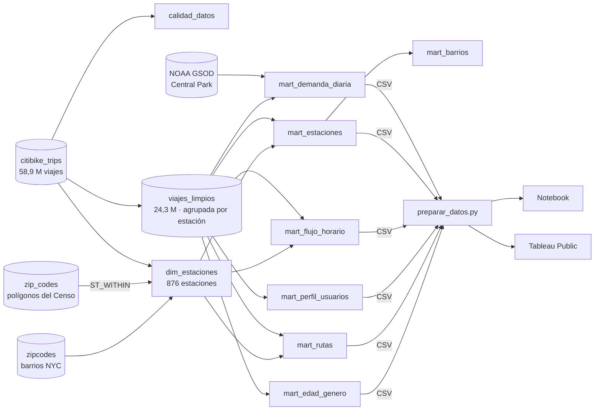
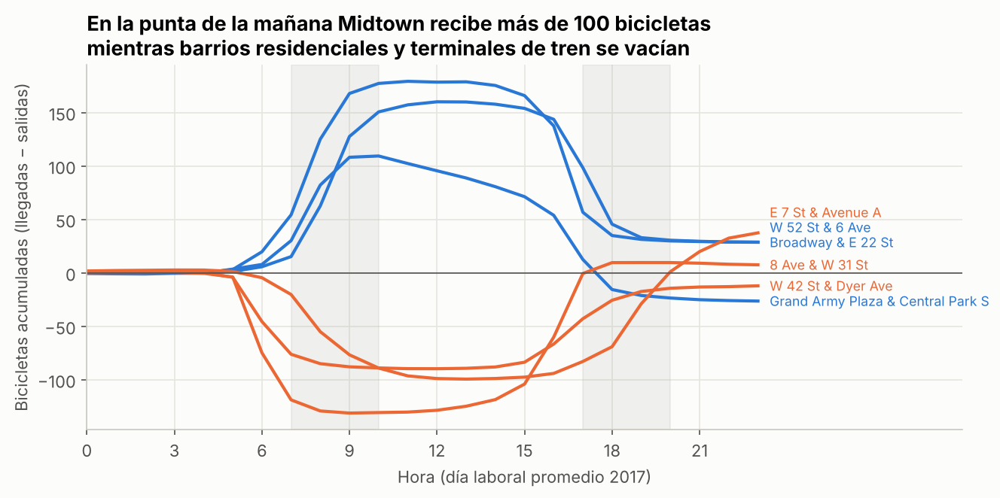
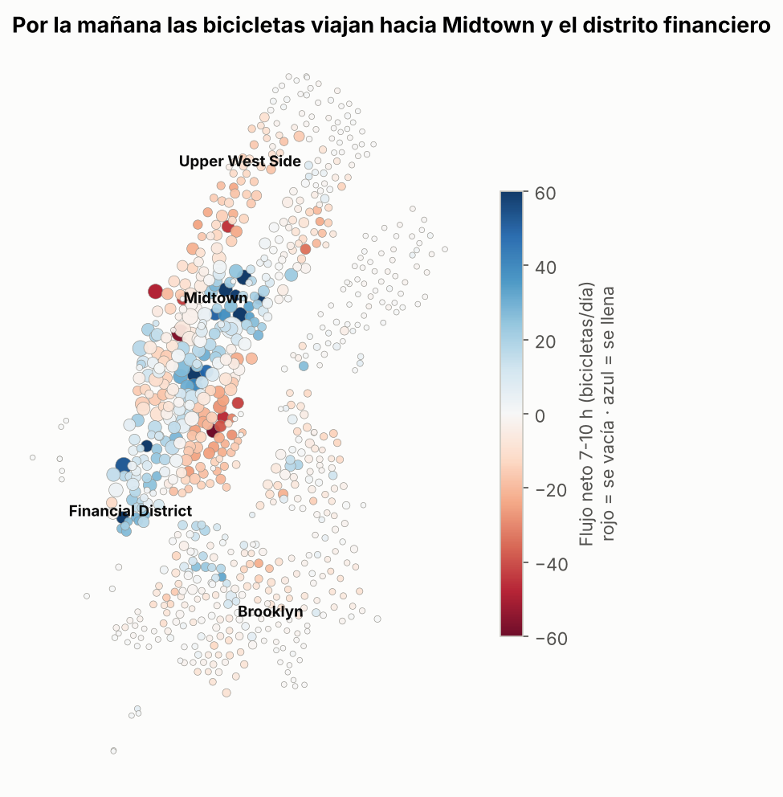
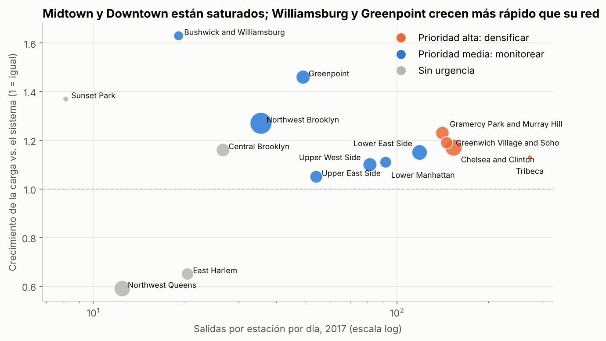

# 🚲 Citi Bike NYC: demanda, clima, rebalanceo y expansión de estaciones con BigQuery

> **Un sistema de bicicletas no falla por falta de bicicletas, sino porque están en el lugar equivocado a la hora equivocada.** Proyecto integral (Planificar → Analizar → Construir → Ejecutar) que procesa 24,3 millones de viajes en Google BigQuery, mide cuánto pesa el clima, calcula hora a hora qué estaciones se vacían o se llenan y propone dónde abrir estaciones. Es una versión ampliada del caso Cyclistic del Google Business Intelligence Certificate.




🔗 **[Ver el dashboard en Tableau Public](#)** *(enlace pendiente de publicación)*

---

## 🅿️ Planificar: el problema de negocio

El equipo de producto prepara el plan del próximo año y necesita responder cuatro preguntas:

| Pregunta | Decisión que habilita |
| --- | --- |
| ¿Cuánto influyen el clima y el día de la semana en la demanda? | Dimensionar flota y personal según el pronóstico |
| ¿Cómo usan el sistema abonados y ocasionales? | Diseñar planes y campañas para cada grupo |
| ¿Qué estaciones se vacían o se llenan, y a qué hora? | Planificar las rutas de rebalanceo |
| ¿En qué barrios conviene abrir o densificar estaciones? | Priorizar la inversión en la red |

## 📊 Resultados principales

| Indicador | Resultado |
| --- | --- |
| Viajes procesados en BigQuery | 24.325.562 (2016-2017, 0,23 % excluido por calidad) |
| Crecimiento comparable (abril-septiembre) | **+21 %** (abonados +20 %, ocasionales +24 %) |
| Efecto de la lluvia | **−12 %** viajes; ocasionales **−24 %** con lluvia fuerte |
| Efecto del fin de semana | Ocasionales **+120 %**, abonados **−32 %** |
| Concentración del rebalanceo | **17 %** de las estaciones = **50 %** de la necesidad diaria |
| Estación más desbalanceada | W 52 St & 6 Ave acumula **+179 bicicletas** a media mañana |
| Expansión | **Densificar** 4 barrios de Manhattan; **ampliar la red** en Williamsburg y Greenpoint |

## 🅰️ Analizar

### Auditoría de calidad

La limpieza se midió en BigQuery con una tabla que cuenta cuántos viajes excluye cada regla.

| Hallazgo | Magnitud | Tratamiento |
| --- | --- | --- |
| Viajes de más de 3 horas (bicicleta no devuelta) | 55.589 | Excluidos |
| Estaciones de prueba fuera de NYC | 221 viajes | Excluidas por coordenadas |
| Año de nacimiento anterior a 1930 | 11.900 | Edad anulada; el viaje se conserva |
| **Faltan oct-2016 a mar-2017 en la tabla pública** | 6 meses | Crecimiento medido solo con abril-septiembre; métricas por día de operación |
| Faltan 23-26 enero 2016 | 4 días | Cierre real por la tormenta de nieve Jonas |
| Código postal 11249 ausente de la tabla de barrios | 11 estaciones | Asignado a Greenpoint, igual que el 11211 del que se separó |



### Clima y día de la semana



Regresión lineal sobre el logaritmo de los viajes diarios, con errores robustos (HC3) y R² de 0,69 a 0,75. Controla temperatura máxima, lluvia, nieve, fin de semana y año.
- **Abonados:** van al trabajo. Llueva poco o mucho, bajan ~11 %, y caen 32 % el fin de semana.
- **Ocasionales:** salen a pasear. Se duplican el fin de semana y la lluvia fuerte los reduce 24 %. Un día de 25 °C tiene casi **7 veces** más ocasionales que uno de 5 °C (los abonados, 2 veces).

### Dos formas de usar la bicicleta



| | Abonados | Ocasionales |
| --- | --- | --- |
| Viajes 2017 | 12,4 millones | 1,7 millones |
| Viajes en fin de semana | 22 % | 47 % |
| Duración mediana | 9,7 min | 21,3 min |
| Vuelven a la misma estación | 1 % | 6 % |

Entre los abonados, el **74 %** de los viajes los hacen hombres y el 40 % personas de 25 a 34 años.

## 🏗️ Construir

### Modelo de datos en BigQuery



- **Geocodificar estaciones, no viajes:** el cruce espacial (`ST_WITHIN`) se hace sobre 876 estaciones y no sobre 24 millones de viajes.
- **Tabla base limpia y agrupada** por estación (`CLUSTER BY`): cada consulta siguiente lee menos datos.
- **Una estación, una ubicación:** se usa la mediana de sus coordenadas y su nombre más frecuente, porque la fuente trae variaciones.

> **Lección aprendida:** la primera versión particionaba la tabla por fecha. En la zona de pruebas de BigQuery cada partición vence a los 60 días **según su fecha**, así que las de 2016-2017 se borraban apenas se creaban y la tabla quedaba vacía. Se diagnosticó con conteos por etapa y se resolvió agrupando por estación en vez de particionar.

### Métrica de rebalanceo

Para cada estación se acumula, hora a hora, el flujo neto (llegadas − salidas) de un día laboral promedio. La **amplitud** (punto más lleno − punto más vacío) es la cantidad de bicicletas que hay que mover o de anclajes que deben quedar libres.



### Puntaje de expansión

Puntaje 0-100 por barrio, con pesos explícitos sobre rangos percentiles:
- **50 % saturación:** salidas por estación por día.
- **30 % crecimiento:** carga por estación frente al sistema.
- **20 % presión de rebalanceo.**

## 🚀 Ejecutar

### A dónde mandar los camiones



- **88 estaciones** se llenan en la mañana: destinos laborales en Midtown y el distrito financiero.
- **75 se vacían:** barrios residenciales como el East Village y el Upper West Side, y también **terminales de transporte**. En Penn Station (8 Ave & W 31 St) y Port Authority (W 42 St & Dyer Ave) la gente llega en tren o bus y sigue en bicicleta.
- **135 estaciones (17 %)** concentran la mitad de la necesidad: ahí se enfocan los camiones y los anclajes extra.

### Dónde crecer



| Prioridad | Barrios | Acción |
| --- | --- | --- |
| **Alta** | Chelsea and Clinton, Tribeca, Gramercy Park and Murray Hill, Greenwich Village and Soho | Densificar: más estaciones y más anclajes por estación |
| **Media** | Lower East Side, Greenpoint, Lower Manhattan, Northwest Brooklyn, Upper West Side… | Ampliar la red en Greenpoint y Williamsburg, donde la carga crece 46-63 % más que el sistema |
| **Sin urgencia** | Northwest Queens, East Harlem, Central Brooklyn | La red creció más rápido que la demanda (Northwest Queens pasó de 13 a 76 estaciones) |

## 📋 Resumen ejecutivo

1. **Rebalancear con foco:** concentrar camiones en las 135 estaciones críticas. Hay que reponer los orígenes (barrios residenciales, Penn Station, Port Authority) antes de las 7:00 y vaciar Midtown antes de la punta de la tarde.
2. **Planificar con el pronóstico:** reducir el rebalanceo en días de lluvia y reforzar la oferta para ocasionales en fines de semana soleados.
3. **Densificar Manhattan bajo la calle 59** (más de 140 salidas por estación al día) y **ampliar la red en Williamsburg y Greenpoint**.
4. **Convertir ocasionales en abonados** con pases de fin de semana, y trabajar la brecha de género: 74 % de los viajes de abonados son de hombres.

## 🗂️ Estructura del repositorio

```
citibike-nyc-demanda-rebalanceo/
├── sql/
│   ├── 01_construir_modelo.sql   # 10 pasos en BigQuery: calidad, limpieza, estaciones y 7 marts
│   └── 02_exportar.sql           # consultas de exportación a CSV
├── data/
│   ├── bigquery/                 # 9 tablas exportadas desde BigQuery
│   └── tableau/                  # 8 tablas enriquecidas para el dashboard
├── src/preparar_datos.py         # correcciones geográficas, rebalanceo y puntaje de expansión
├── notebooks/analisis_citibike.ipynb
├── tableau/GUIA_TABLEAU.md
├── docs/img/                     # portada y gráficos
├── requirements.txt
├── LICENSE
└── README.md
```

## ▶️ Cómo reproducirlo

1. **BigQuery** (la zona de pruebas gratuita alcanza): crea un dataset en la ubicación **US**, sube la tabla `zipcodes` del curso, reemplaza `tu-proyecto.cyclistic` en `sql/01_construir_modelo.sql` y ejecútalo completo.
2. Exporta cada tabla con `sql/02_exportar.sql` (**Guardar resultados → CSV**) a `data/bigquery/`. Los CSV ya vienen incluidos, así que este paso es opcional.
3. Prepara y analiza:

```bash
git clone https://github.com/Cristobal-111/citibike-nyc-demanda-rebalanceo.git
cd citibike-nyc-demanda-rebalanceo
pip install -r requirements.txt
python src/preparar_datos.py
jupyter notebook notebooks/analisis_citibike.ipynb
```

## ⚠️ Limitaciones

- Faltan 6 meses en la fuente pública; no hay datos del invierno 2016-2017.
- No hay capacidad de anclajes por estación en este período: la saturación se mide por demanda, no por ocupación.
- Los efectos del clima son asociaciones observacionales, con el clima de una sola estación (Central Park).
- Los nombres de barrios vienen en inglés, como en la tabla de códigos postales del curso.

## 📚 Fuente de datos

- [NYC Citi Bike Trips](https://console.cloud.google.com/marketplace/details/city-of-new-york/nyc-citi-bike) · `bigquery-public-data.new_york_citibike`
- [US Geographic Boundaries](https://console.cloud.google.com/marketplace/product/united-states-census-bureau/us-geographic-boundaries) · `bigquery-public-data.geo_us_boundaries`
- [NOAA GSOD](https://console.cloud.google.com/marketplace/details/noaa-public/gsod) · `bigquery-public-data.noaa_gsod`
- Tabla de códigos postales y barrios del Google Business Intelligence Certificate

## 🔗 Serie de proyectos

- 🏥 [Inasistencia a citas médicas · Proyecto integral PACE](https://github.com/Cristobal-111/medical-no-show-pace)
- 🛒 [Plataforma de datos de e-commerce · Pipeline, calidad y ML](https://github.com/Cristobal-111/plataforma-datos-ecommerce)
- 🚲 **Citi Bike NYC · BigQuery, rebalanceo y expansión (este repositorio)**

## 👤 Autor

**Cristóbal Rojas Troncoso** · Ingeniero Civil Industrial | Data & Analytics · Business Intelligence
[LinkedIn](https://www.linkedin.com/in/cristobal-rojas-troncoso/) · [GitHub](https://github.com/Cristobal-111)
