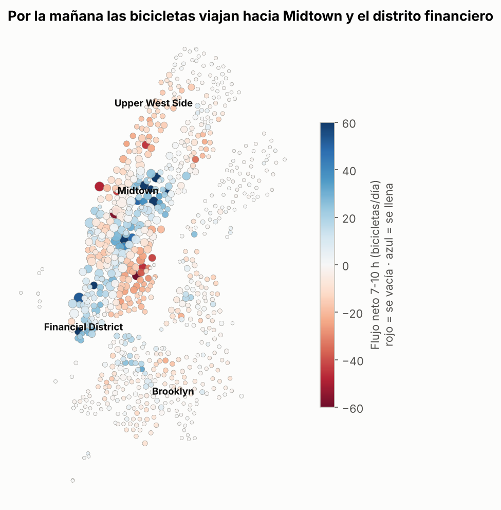
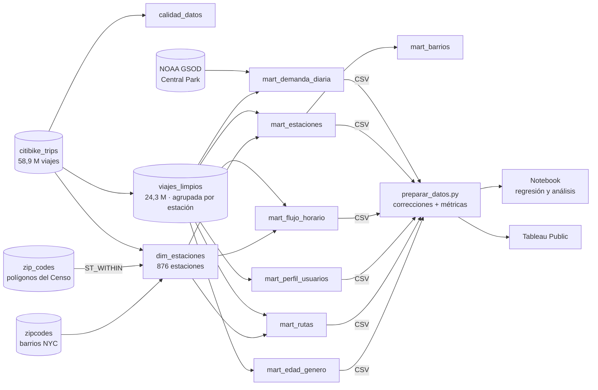
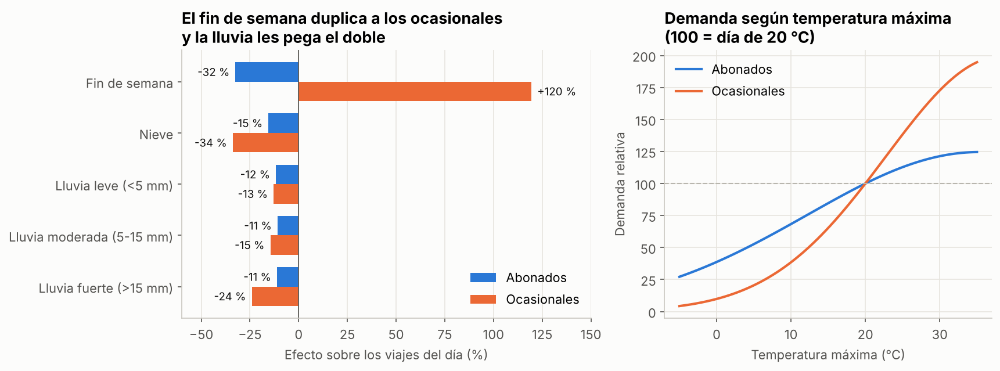
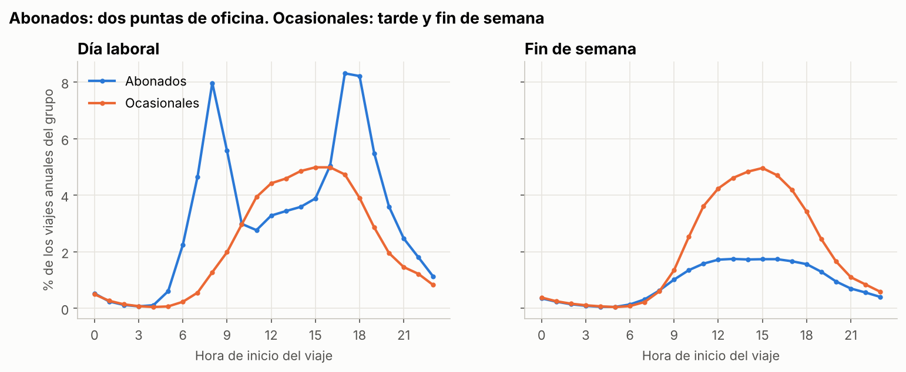
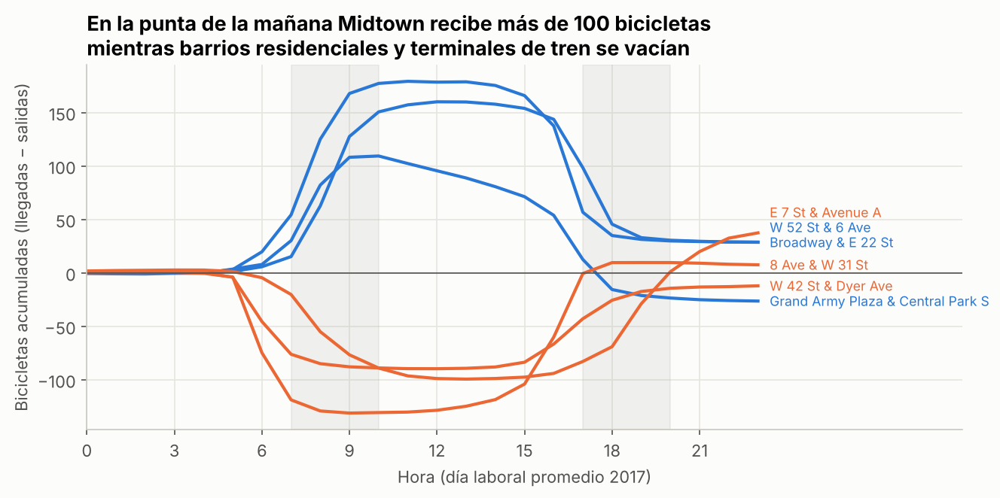
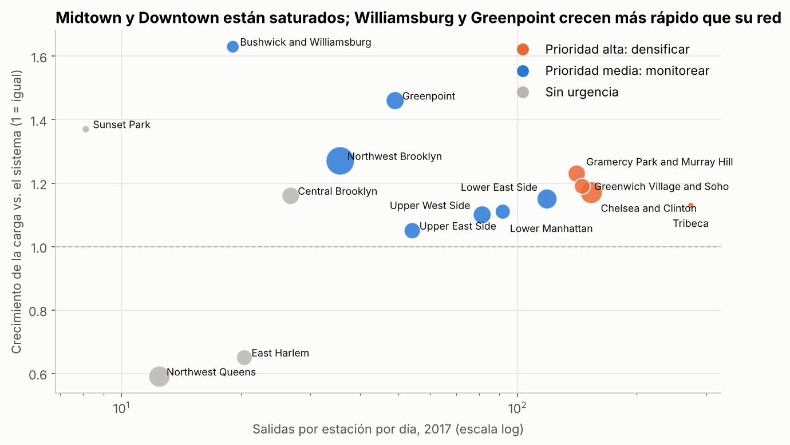

# 🚲 Citi Bike NYC: demanda, clima, rebalanceo y expansión de estaciones

> Análisis de **24,3 millones de viajes** (2016-2017) procesados en **Google BigQuery** con SQL: modelo de datos con cruces geoespaciales, regresión de la demanda según el clima, cálculo hora a hora de qué estaciones se vacían o se llenan, y un puntaje para decidir en qué barrios abrir estaciones. Es una versión ampliada del caso Cyclistic del **Google Business Intelligence Certificate**.


🔗 **[Ver el dashboard en Tableau Public](#)** *(enlace pendiente de publicación)*

---

## ⚡ El resultado en 30 segundos

| Pregunta | Respuesta |
| --- | --- |
| ¿Cuánto creció el sistema? | **+21 %** en viajes (abril-septiembre 2017 vs 2016); los ocasionales crecieron más (+24 %). |
| ¿Cuánto pesa el clima? | Cualquier lluvia baja los viajes **~12 %**. Los ocasionales caen **24 %** con lluvia fuerte y **se duplican** el fin de semana; los abonados caen **32 %** el fin de semana. |
| ¿Cómo se usa la bicicleta? | Abonados: viajes de **9-10 min** en las puntas de oficina (8:00 y 17:00-18:00). Ocasionales: **21 min**, de tarde y en fin de semana. |
| ¿Dónde está el problema operativo? | El **17 % de las estaciones** concentra la **mitad** de la necesidad de rebalanceo. W 52 St & 6 Ave acumula **+179 bicicletas** a media mañana. |
| ¿Dónde crecer? | **Densificar** Chelsea, Gramercy, Greenwich Village y Tribeca (más de 140 salidas por estación al día) y **ampliar la red** en Williamsburg y Greenpoint, donde la carga crece más rápido que el sistema. |



## 🏗️ Arquitectura



**Decisiones de diseño en BigQuery**
- **Geocodificar estaciones, no viajes.** El cruce espacial (`ST_WITHIN` contra los polígonos postales) se hace sobre 876 estaciones y no sobre 24 millones de viajes: mucho más rápido y barato.
- **Tabla base limpia y agrupada** (`CLUSTER BY` estación): todas las consultas siguientes leen menos datos.
- **Calidad medida, no supuesta:** una tabla registra cuántos viajes excluye cada regla.
- **Coordenadas, nombre y barrio por estación** con la mediana de sus coordenadas y su nombre más frecuente, porque la fuente trae variaciones.

## 🔎 Calidad de los datos

| Hallazgo | Magnitud | Tratamiento |
| --- | --- | --- |
| Viajes de más de 3 horas (bicicleta no devuelta) | 55.589 | Excluidos |
| Estaciones de prueba fuera de NYC | 221 viajes | Excluidas por coordenadas |
| Año de nacimiento anterior a 1930 | 11.900 | Edad anulada; el viaje se conserva |
| **Faltan oct-2016 a mar-2017 en la tabla pública** | 6 meses | El crecimiento se compara solo con abril-septiembre; las métricas por estación, por día de operación |
| Faltan 23-26 enero 2016 | 4 días | Cierre real por la tormenta de nieve Jonas |
| Código postal 11249 (Williamsburg) ausente de la tabla de barrios | 11 estaciones | Asignado a Greenpoint, igual que el 11211 del que se separó |

**Total:** de 24.381.318 viajes brutos quedaron **24.325.562** (0,23 % excluido).

## 📊 Hallazgos

### 1. Clima y día de la semana



Regresión lineal sobre el logaritmo de los viajes diarios, con errores robustos (HC3) y R² de 0,69 a 0,75. Controla temperatura máxima, lluvia, nieve, fin de semana y año. Un día de 25 °C tiene **2 veces más abonados** y **casi 7 veces más ocasionales** que uno de 5 °C.

### 2. Dos formas de usar la bicicleta



| | Abonados | Ocasionales |
| --- | --- | --- |
| Viajes 2017 | 12,4 millones | 1,7 millones |
| Viajes en fin de semana | 22 % | 47 % |
| Duración mediana | 9,7 min | 21,3 min |
| Vuelven a la misma estación | 1 % | 6 % |

Entre los abonados, el **74 %** de los viajes los hacen hombres y el 40 % personas de 25 a 34 años.

### 3. Rebalanceo



Se acumuló, hora a hora, el flujo neto (llegadas − salidas) de un día laboral promedio de 2017. La **amplitud** del día es la cantidad de bicicletas que hay que mover o de anclajes que deben quedar libres.
- **88 estaciones** se llenan en la mañana: destinos laborales en Midtown y el distrito financiero.
- **75 se vacían:** barrios residenciales como el East Village y el Upper West Side, y también **terminales de transporte**. En Penn Station (8 Ave & W 31 St) y Port Authority (W 42 St & Dyer Ave) la gente llega en tren o bus y sigue en bicicleta.
- **135 estaciones (17 %)** concentran el **50 %** de toda la necesidad de rebalanceo: ahí conviene enfocar los camiones y los anclajes extra.

### 4. Expansión



Puntaje 0-100 por barrio: 50 % saturación (salidas por estación por día), 30 % crecimiento de la carga respecto del sistema y 20 % presión de rebalanceo.

| Prioridad | Barrios | Acción |
| --- | --- | --- |
| **Alta** | Chelsea and Clinton, Tribeca, Gramercy Park and Murray Hill, Greenwich Village and Soho | Densificar: más estaciones y más anclajes por estación |
| **Media** | Lower East Side, Greenpoint, Lower Manhattan, Northwest Brooklyn, Upper West Side… | Monitorear; ampliar la red en Greenpoint y Williamsburg, donde la carga crece 46-63 % más que el sistema |
| **Sin urgencia** | Northwest Queens, East Harlem, Central Brooklyn | La red creció más rápido que la demanda (por ejemplo, Northwest Queens pasó de 13 a 76 estaciones) |

## 📁 Estructura

```
citibike-nyc-demanda-rebalanceo/
├── sql/
│   ├── 01_construir_modelo.sql   # 10 pasos en BigQuery: calidad, limpieza, estaciones y 7 marts
│   └── 02_exportar.sql           # consultas de exportación a CSV
├── data/
│   ├── bigquery/                 # 9 tablas exportadas desde BigQuery
│   └── tableau/                  # 8 tablas enriquecidas, listas para el dashboard
├── src/preparar_datos.py         # correcciones geográficas, rebalanceo y puntaje de expansión
├── notebooks/analisis_citibike.ipynb
├── tableau/GUIA_TABLEAU.md
└── docs/img/                     # gráficos
```

## ▶️ Cómo reproducirlo

1. **BigQuery** (la zona de pruebas gratuita alcanza): crea un dataset en la ubicación **US**, sube la tabla `zipcodes` del curso, reemplaza `tu-proyecto.cyclistic` en `sql/01_construir_modelo.sql` y ejecútalo completo.
2. Exporta cada tabla con `sql/02_exportar.sql` (**Guardar resultados → CSV**) a `data/bigquery/`.
3. Prepara y analiza:

```bash
pip install -r requirements.txt
python src/preparar_datos.py
jupyter notebook notebooks/analisis_citibike.ipynb
```

> **Lección aprendida:** la primera versión particionaba `viajes_limpios` por fecha. En la zona de pruebas, BigQuery vence cada partición a los 60 días **según su fecha**, así que las de 2016-2017 se borraban apenas se creaban y la tabla quedaba vacía. Se diagnosticó con conteos por etapa y se resolvió agrupando por estación en vez de particionar.

## ⚠️ Limitaciones

- Faltan 6 meses en la fuente pública; no hay datos de invierno 2016-2017.
- No hay capacidad de anclajes por estación en este período: la saturación se mide por demanda, no por ocupación.
- Los efectos del clima son asociaciones observacionales; el clima es de una sola estación (Central Park).
- Los nombres de barrios vienen en inglés, como en la tabla de códigos postales del curso.

## 📚 Fuentes

- [NYC Citi Bike Trips](https://console.cloud.google.com/marketplace/details/city-of-new-york/nyc-citi-bike) · `bigquery-public-data.new_york_citibike`
- [US Geographic Boundaries](https://console.cloud.google.com/marketplace/product/united-states-census-bureau/us-geographic-boundaries) · `bigquery-public-data.geo_us_boundaries`
- [NOAA GSOD](https://console.cloud.google.com/marketplace/details/noaa-public/gsod) · `bigquery-public-data.noaa_gsod`
- Tabla de códigos postales y barrios del Google Business Intelligence Certificate

## 👤 Autor

**Cristóbal Rojas Troncoso** · Ingeniero Civil Industrial | Data & Analytics · Business Intelligence
[LinkedIn](https://www.linkedin.com/in/cristobal-rojas-troncoso/) · [GitHub](https://github.com/Cristobal-111)
